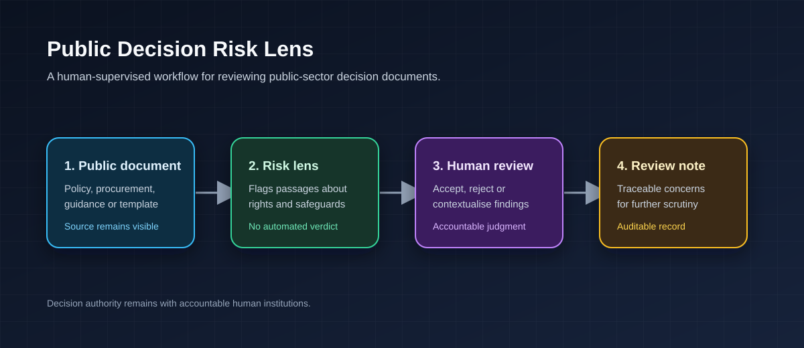

# Public Decision Risk Lens

> **Final project for the [Building AI course](https://buildingai.elementsofai.com/).**

Try the prototype: https://abdimannor.github.io/public-decision-risk-lens/prototype/

## Summary

**Building AI course project.** Public Decision Risk Lens is a human-supervised concept for reviewing public-sector decision documents before an AI-supported or automated process is introduced. It helps reviewers identify passages that may require closer attention because they affect transparency, accountability, fairness, privacy, or people’s ability to question a decision.

*An official document-signing process, used here as an illustration of how public decisions become formalised. The project concerns document review, not the institution or people depicted.*

### Project status

- **Current stage:** concept plus an early pattern-matching prototype
- **Future stage:** taxonomy developed with practitioners and tested on public documents
- **Decision authority:** remains human, accountable, and open to challenge

## Background

Public authorities increasingly use digital tools to support policy development, procurement, service delivery, and administrative decision-making. These tools can improve consistency and efficiency, but they can also create risks when their purpose, data use, responsibility, or limits are unclear.

The project addresses an early stage in this process: reviewing documents before a system is procured or deployed. Its purpose is not to decide whether a system is lawful, fair, or legitimate. Instead, it helps public-sector teams locate questions that require professional, legal, democratic, and human consideration.

## How is it used?

A policy analyst, procurement officer, data-protection specialist, or oversight team selects a public policy, procurement specification, impact assessment, guideline, or decision template for review. The proposed tool highlights passages that may concern transparency, accountability, discrimination, privacy, contestability, human oversight, security, or misuse.

Each flag is linked to the relevant passage and risk category. A human reviewer then accepts, rejects, or contextualises the flag and records a review note. The intended output is an auditable discussion aid, not an automated verdict.

### Prototype

The `prototype/` folder contains a small version of the review workflow with no build step and no external services. To try it, use the [live copy](https://abdimannor.github.io/public-decision-risk-lens/prototype/) or open `prototype/index.html` in a browser, and paste a document, open or drop a `.txt`, `.md`, `.html`, `.docx` or PDF file, or load one of the samples (the fictional one, or the real Swedish and EU texts). PDF text is extracted in the browser with a vendored copy of pdf.js (`prototype/vendor/pdfjs/`, Apache-2.0), and each passage keeps its page number in flags and exports. PDF import needs the page served over http (for example `node tests/server.js`), because browsers block module scripts on `file://`. Scanned PDFs without a text layer are not supported (no OCR). All processing stays in the browser. The text, decisions and notes are stored only in your browser (local storage) so they survive a reload; the Clear review button removes them.

What it does:

- splits the text into numbered passages and highlights words and phrases from a visible taxonomy (`prototype/taxonomy.js`) with English and Swedish patterns for the eight categories;
- lists each flag by category with the passage, the matched term and the rule that fired;
- notes topics such as appeal or human review that are not found in this text, as a prompt to check other documents rather than as a finding;
- lets a reviewer accept, reject or contextualise each flag, write a note, and export a review log as JSON or Markdown;
- shows a risk map of the whole document: one row per category, one cell per passage, with counts per category (counts are matches, not severity);
- prints an A4 review report with the flags, decisions, notes and the advisory notice.

What it does not do: it does not understand context, judge lawfulness or fairness, score people or make decisions. It will miss risks and flag ordinary language. The unit tests run with `node --test prototype/engine.test.js`; browser tests run with `npm install` and `npx playwright test`.

### Reviewer tools in the prototype

- **Your own rules.** A reviewer can add a term or phrase, pick a category and write a review question. The rule runs at once next to the built-in taxonomy. Its flags carry a "Reviewer-added" badge and a `reviewer-added/...` rule text in the JSON and Markdown logs and the printed report. Rules are saved in the browser and can be exported or imported as a JSON rule pack.
- **Compare two versions.** Paste or load an earlier and a revised version. Flags are paired by rule and by shared words in the passage (at least half), and listed as appearing, disappearing or persisting. A flag that disappears may only mean the wording changed; a reviewer reads both passages.
- **Why this flag?** Each flag opens an explanation: the exact rule, the matched words in context, the category description and guiding question, and the absence checks for the same category with their status.
- **Svenska or English.** The interface, categories, review questions, absence checks, printed report and export headings come in Swedish and English. Swedish is the default when the browser asks for Swedish; the switch in the notice bar is remembered. Trigger patterns are the same in both languages.
- **Keyboard-first review.** `j` and `k` move between flags, `a`, `r` and `c` accept, reject or contextualise, `n` opens the note, `?` shows the shortcuts. Keys are ignored while typing in a text field.
- **Progress meter.** A sticky meter counts reviewed flags overall and per category, with a button to jump to the next flag without a decision. It counts decisions, not risk.

## Data sources and AI methods

A future prototype could use public Swedish and EU policy documents, official guidance, procurement documents, and published algorithmic-impact assessments. The quality, completeness, and institutional context of these documents would remain essential limitations.

The prototype ships three samples in a Load sample menu. One is fictional. Two are verbatim excerpts from genuine official texts, with title, issuing body, date, document number, source URL, retrieval date and reuse basis shown in the interface, the exports and the printed report:

- Förvaltningslag (2017:900), 28-33 §§ (Myndighetens beslut), SFS 2017:900, consolidated text from Sveriges riksdag: https://data.riksdagen.se/dokument/sfs-2017-900.text. Swedish statutes are not protected by copyright (9 § upphovsrättslagen).
- Regulation (EU) 2024/1689 (Artificial Intelligence Act), Article 14 (Human oversight) and Article 86 (Right to explanation of individual decision-making), from EUR-Lex: https://eur-lex.europa.eu/legal-content/EN/TXT/HTML/?uri=OJ:L_202401689. Reusable under Commission Decision 2011/833/EU; only the Official Journal text is authentic.

Each excerpt was checked word for word against the source text (whitespace normalised) before it was added. After a review, a summary card lists counts by decision and category, the reviewer-added rules that matched and the absence checks, in English and Swedish, and the same summary appears in the printed report.

The initial approach should be conservative: source-linked information retrieval and transparent pattern matching. Later work could assess supervised classification or retrieval-augmented language models, but only where every output retains source references, confidence indicators, review logs, and mandatory human validation.

The project must not score citizens, determine eligibility, infer protected characteristics, or make final decisions about individuals.

## Challenges

Institutional risk cannot be reduced to keywords or a model score. A system may miss important concerns, flag ordinary language without context, or reproduce assumptions present in its source material. Public documents can also omit the operational practices, datasets, and informal routines that shape real outcomes.

The project cannot establish that a policy or system is lawful, fair, or legitimate. Human expertise, legal review, affected groups’ perspectives, and democratic accountability remain necessary throughout the process.

## What next?

The next step would be to develop a transparent risk taxonomy with public-sector practitioners, legal experts, and affected groups. A small source-linked prototype could then be tested on public documents, followed by an expert-labelled evaluation set that measures usefulness, false-positive rates, and reviewer agreement.

Any pilot should remain low-risk and advisory. It should strengthen review and accountability, never replace public authority, individual due process, or the right to challenge a decision.

## Acknowledgments

- The original workflow diagram in `assets/risk-lens-workflow.svg` was created for this project and is covered by this repository’s [CC BY 4.0 licence](LICENSE).
- The illustrative photograph, [*Signing of the General Appropriations Act of 2025 A*](https://commons.wikimedia.org/wiki/File:Signing_of_the_General_Appropriations_Act_of_2025_A.jpg), is by the Philippine Presidential Communications Office and is marked **Public Domain** on Wikimedia Commons. It is used only as a general illustration of official document-signing.
- No external code is included. `prototype/eval/heldout.json` holds short verbatim excerpts from the public documents listed under Evaluation.

## Evaluation

`npm run eval` scores the engine against a small hand-annotated gold set (`prototype/eval/gold.json`, 54 passages from the three samples, 51 expected labels, one AI annotator, no inter-annotator agreement). After the error-analysis fixes: precision 82%, recall 73% (before: 76% and 51%). The fixes were made on the same passages, so these figures are optimistic.

`npm run eval -- heldout` scores it on a held-out set (`prototype/eval/heldout.json`): 30 verbatim passages from seven real Swedish and EU documents the engine was never tuned on, chosen by reading and labelled blind (labels committed before the first engine run). Its first score was the honest estimate; a later precision round used it for development, so it now counts as development data.

| Set | Passages | Labels | Precision | Recall | F1 |
| --- | ---: | ---: | ---: | ---: | ---: |
| Tuning (samples) | 54 | 51 | 82% | 73% | 77% |
| Held-out (new documents), first score | 30 | 57 | 44% | 72% | 55% |
| Tuning, after precision round | 54 | 51 | 84% | 71% | 77% |
| Held-out, after precision round (development data) | 30 | 57 | 65% | 82% | 73% |
| **Frozen test set, before precision round** | 26 | 43 | 36% | 63% | 46% |
| **Frozen test set, after precision round (the honest number)** | 26 | 43 | 42% | 72% | 53% |

On the first score recall held and precision dropped because broad stems ("kontroll"/"control", "profiling", "automatiser", "GDPR") fired on mere mentions. The precision round added context gates (a topic word such as "profiling" or "GDPR" flags only with a cue for the actual concern in the same passage) and removed "control" from misuse. Because both sets were used to develop it, a third, frozen test set (`prototype/eval/test2.json`: 26 passages from six further documents, labelled blind on a separate branch) was scored once afterwards: precision 36% to 42%, recall 63% to 72%. That is the number to quote; the development numbers overstate the gain. Both sets have a single AI annotator, so part of the gap may be the labels. Per-category numbers, error list and method: `prototype/evaluation.html`.

### Round 4: oversight and accountability (development numbers)

Human oversight now also fires when a passage says a case is decided or examined without a person or describes the extent of manual review; "handläggare" and "oversight" need a review cue nearby. Accountability words ("ansvar", "responsible") need a cue that responsibility is unclear, shared, shifted or tied to an error, not just a named body. All three sets were used for development, so these are not honest estimates.

| Set | Labels | Overall P / R before | Overall P / R after | Accountability P / R | Human oversight P / R |
| --- | ---: | --- | --- | --- | --- |
| Tuning (gold) | 47 | 89% / 66% | 87% / 87% | 100% / 22% to 82% / 100% | 86% / 67% to 90% / 100% |
| Held-out (development) | 57 | 69% / 82% | 70% / 86% | 83% / 63% to 86% / 75% | 75% / 92% to 76% / 100% |
| test2 (development in this round) | 43 | 48% / 70% | 52% / 74% | 33% / 20% to 75% / 60% | 50% / 100% to 56% / 100% |

### Definitions

Labels follow the [annotation guide](docs/annotation-guide.md): a definition per category, what counts and what does not, and invented borderline examples. Its key rule: a passage that only mentions automation, an algorithm, a model or AI is not a transparency or human-oversight concern by itself. The tool shows such passages with a neutral "Mentions automation" / "Nämner automatisering" tag, which is not a risk flag and is not counted in the progress meter, summary card or evaluation. The tuning and held-out sets were re-read against the guide without running the engine (four tuning labels removed, none on held-out; see [the relabel log](docs/relabel-log.md)).

| Set (after the guide) | Labels | Precision | Recall |
| --- | ---: | ---: | ---: |
| Tuning, relabelled | 47 | 89% (74% with the previous engine) | 66% (68%) |
| Held-out, development data | 57 | 69% (65%) | 82% (82%) |
| **Frozen test set, labels from before the guide** | 43 | **48%** (42%) | **70%** (72%) |

Caveat: the frozen test set was labelled before the guide existed and its labels stay frozen, so it still counts some bare mentions as concerns. The gap between the development sets and the frozen set is partly that, partly patterns that still fire on words that do not carry the concern. The frozen set has now been scored twice; the next honest number needs a new blind test set labelled with the guide.

Held-out sources (Swedish documents reused under 9 § upphovsrättslagen; EU documents under Commission Decision 2011/833/EU):

- [JO, dnr 4778-2006 (2008-01-21): Ett fel i Försäkringskassans automatiserade behandling ...](https://www.jo.se/besluten/ett-fel-i-forsakringskassans-automatiserade-behandling-av-ett-arende-om-sjukpenninggrundande-inkomst-fick-till-foljd-att-den-forsakrade-aterkallade-ett-overklagande-varigenom-hon-fororsakades-en-ratt/) (2 passages)
- [JO, dnr 3232-2023 (2023-06-19): En undersökning av hur 11 och 12 §§ förvaltningslagen tillämpas](https://www.jo.se/besluten/en-undersokning-av-hur-11-och-12-%c2%a7%c2%a7-forvaltningslagen-tillampas-hos-nagra-olika-myndigheter/) (3 passages)
- [JO, dnr R 32-2024 (2024-05-02): Yttrande över Skatteverkets promemoria om uppgift om beslutsfattare](https://www.jo.se/app/uploads/2024/05/remissyttrande-r-32-2024.pdf) (1 passages)
- [Riksrevisionen, RiR 2020:22: Automatiserat beslutsfattande i statsförvaltningen](https://www.riksrevisionen.se/download/18.2008b69c18bd0f6ed3f2a460/1605694925646/RiR%202020_22%20Anpassad.pdf) (7 passages)
- [IMY, IMY-2024-9162: GDPR vid användning av generativ AI](https://www.imy.se/globalassets/dokument/rapporter/gdpr-vid-anvandning-av-generativ-ai_imy-2024-9162.pdf) (4 passages)
- [Article 29 Working Party, WP251rev.01: Guidelines on automated individual decision-making and profiling](https://ec.europa.eu/newsroom/article29/redirection/document/49826) (11 passages)
- [European Ombudsman, SI/4/2024/MIK (2024-12-05): Closing note on how the Commission decides on and uses AI](https://www.ombudsman.europa.eu/en/doc/closing-note/en/196934) (2 passages)
